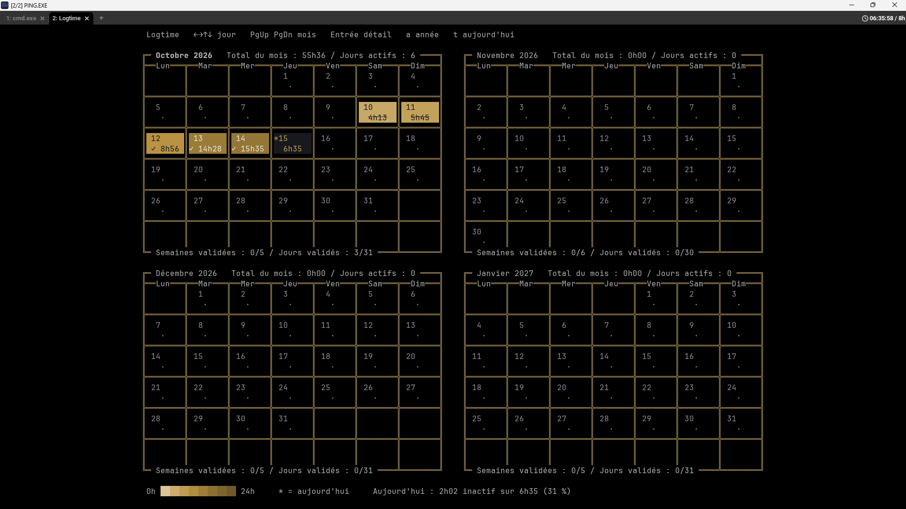
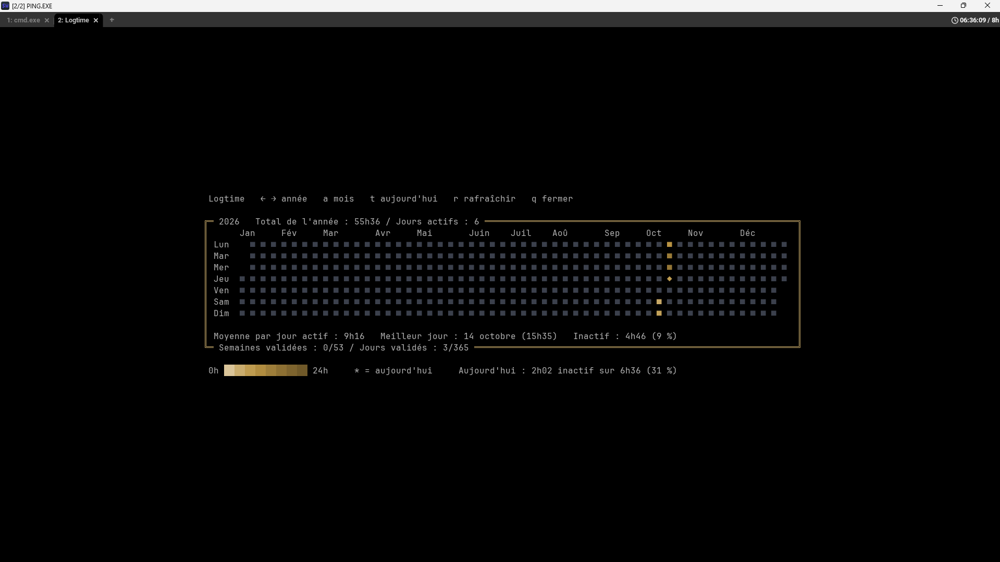
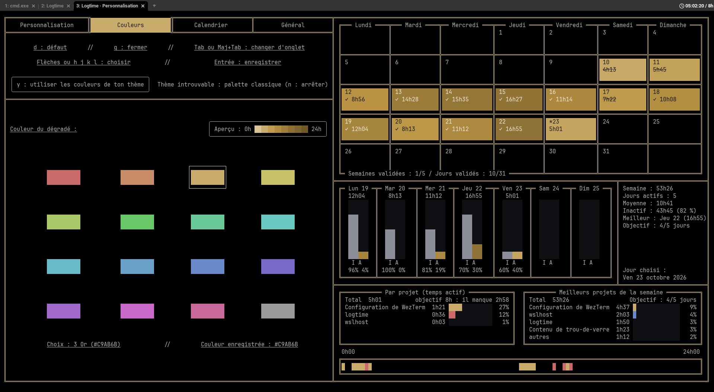

# logtime.wezterm

[English](README.md) · **Français**

Un plugin [WezTerm](https://wezterm.org) qui **compte le temps passé dans ton terminal** et l'affiche dans la barre d'onglets, avec un **calendrier interactif**, une **vue d'ensemble** (l'année, le mois, la semaine, le temps actif / inactif, les projets et la frise sur un seul écran) et une **page de réglages**. Rien d'autre à installer : tout se passe dans WezTerm.



## Fonctionnalités

- **Le compteur du jour dans la barre d'onglets** (`05:12:30`), sans rien à brancher : il s'affiche à droite de la barre normale, ou dans [tabline.wez](https://github.com/michaelbrusegard/tabline.wez) si tu l'utilises.
- **Objectif du jour** : `05:12:30 / 7h`, puis `✓ 07:03:10` en couleur, et une notification 🎉 une fois par jour quand il est atteint.
- **Calendrier** (`F2`) : plusieurs mois côte à côte selon la taille de la fenêtre, un dégradé de couleur par jour, totaux, séries, semaines et jours validés.
- **Vue d'ensemble** (`Entrée` dans le calendrier), tout sur un seul écran, sur toute la fenêtre :
  - l'**année**, une case par jour, avec les mois en dessous ;
  - le **mois** choisi, avec l'objectif jour par jour et les semaines et jours validés ;
  - la **semaine** choisie : deux barres par jour (inactif et actif), et ses chiffres (total, jours actifs, moyenne, meilleur jour, objectif) ;
  - les **projets du jour choisi** et les **meilleurs projets de la semaine** ;
  - la **frise** du jour choisi.

  Un projet garde la même couleur partout sur l'écran.
- **Temps inactif** : quand rien ne bouge dans le terminal pendant 5 minutes, la pause est notée comme inactive (le compteur la compte quand même).
- **Temps par projet** : chaque seconde va au projet de l'onglet que tu regardes (son dossier, par exemple `~/42/C05/ex02` → `42/C05`).
- **Page de réglages** (`F4`) : couleurs (16 couleurs, ou celles de ton thème WezTerm), disposition du calendrier, encadrés, langue, objectif. Chaque changement est enregistré et appliqué tout de suite.
- **Sauvegarde sûre** : écriture vérifiée après coup, copie de secours, fichier illisible mis de côté et jamais écrasé.
- **Français et anglais.**

| Vue d'ensemble | Réglages (`F4`) |
|---|---|
|  |  |

## Installation

Dans ton `wezterm.lua` :

```lua
local wezterm = require("wezterm")
local config = wezterm.config_builder()

-- d'abord tes couleurs / ton thème (le plugin peut te proposer les couleurs de ton thème)

local logtime = wezterm.plugin.require("https://github.com/Kasouker/logtime.wezterm")
logtime.apply_to_config(config, {
	lang = "fr", -- l'interface est en anglais par défaut
	goal_hours = 7, -- facultatif : un objectif par jour
})

return config
```

C'est tout : le compteur apparaît dans la barre d'onglets, `F2` ouvre le calendrier, `F4` les réglages.

> `apply_to_config(config, { ... })` prend **une seule** table d'options. Appelle-la **après** avoir choisi ton thème de couleurs si tu veux que le plugin te propose ses couleurs.

**Mettre à jour** : WezTerm ne télécharge un plugin qu'une fois. Pour avoir une nouvelle version, lance `wezterm.plugin.update_all()` (par exemple dans la fenêtre de débogage, `Ctrl+Shift+L`), puis recharge la config.

## Touches

| Touche | Où | Action |
|---|---|---|
| `F2` | partout | ouvre le calendrier dans un nouvel onglet (ou le remet devant) |
| `F4` | partout | ouvre la page de réglages |

**Dans le calendrier** (il montre les mois ; on se déplace dans la vue d'ensemble) : `Entrée` vue d'ensemble, sur aujourd'hui (ou sur le jour où tu l'as quittée) · `t` retour au mois d'aujourd'hui · `r` rafraîchir · `q` ou `Échap` fermer.

**Dans la vue d'ensemble** (il lui faut une fenêtre d'au moins 120 colonnes × 34 lignes) : `←` `→` (ou `h` `l`) jour · `↑` `↓` (ou `k` `j`) semaine · `Maj+Tab` `Tab` (ou `PgUp` `PgDn`) mois (et l'année, après décembre ou avant janvier) · `t` aujourd'hui · `Entrée` ou `Échap` retour au calendrier, sur le mois où tu étais · `r` rafraîchir · `q` fermer.

**Dans la page de réglages** (elle remplit toute la fenêtre, avec un aperçu à droite quand il y a la place, dessiné comme la vue d'ensemble : le mois, la semaine et ses chiffres, les projets du jour et les meilleurs de la semaine, et la frise de la journée) : `Tab` / `Maj+Tab` onglet suivant / précédent (Couleurs, Calendrier, Général) · flèches ou `h j k l` choisir · `Entrée` enregistrer une couleur · `←` `→` changer une valeur (enregistrée tout de suite) · `d` valeur par défaut · `y` / `n` utiliser (ou non) les couleurs de ton thème · `q` ou `Échap` fermer.

Les touches de la page n'agissent que dans l'onglet de la page : ailleurs, une touche va à ton shell comme d'habitude.

## Configuration

Les options sont lues dans cet ordre (la dernière gagne) : **valeurs par défaut du plugin → options de `wezterm.lua` → fichier de réglages** (écrit par la page `F4` : tes choix dans la page ont donc toujours un effet).

### Réglages (dans `wezterm.lua` ou dans la page `F4`)

| Nom | Valeurs | Défaut | Rôle |
|---|---|---|---|
| `lang` | `"en"`, `"fr"` | `"en"` | langue de l'interface (anglais ou français ; aussi dans `F4`, onglet Général) |
| `week_starts_on` | `"monday"`, `"sunday"` | `"monday"` | premier jour de la semaine |
| `goal_hours` | `0` (aucun), ou de 0,5 à 24 | aucun | heures par jour qui comptent pour « objectif atteint » |
| `goal_days` | 1 à 7 | `5` | jours à l'objectif qui font une semaine validée |
| `count_idle` | `true` / `false` | `true` | `false` : le temps inactif n'est pas compté — le compteur, l'objectif du jour, le calendrier et l'aperçu ne montrent que le temps actif, et la vue d'ensemble une seule barre par jour (les fichiers gardent tout) |
| `show_timeline` | `true` / `false` | `true` | la frise du jour, en bas de l'aperçu de `F4` (onglet Calendrier, bloc Aperçu) et de la vue d'ensemble ; avec elle, chaque projet a sa couleur, la même sur la frise et dans les listes de projets (sans elle, les barres gardent la couleur du jour, et la vue d'ensemble donne la place de la frise aux projets) |
| `max_months` | 1 à 12 | `12` | nombre de mois maximum (autant que la fenêtre en contient, jusqu'à ce nombre) |
| `months_anchor` | `"last"`, `"first"` | `"last"` | le mois choisi est le dernier affiché, ou le premier |
| `center` | `true`, `false` | `true` | centrer le calendrier dans la fenêtre |
| `gradient` | `true`, `false` | `true` | dégradé de couleur (`false` : quatre niveaux) |
| `gradient_color` | `"#RRGGBB"` | `"#C9AB6B"` (or) | teinte du dégradé |
| `gradient_light`, `gradient_dark` | 0 à 1 | `0.8`, `0.3` | luminosité d'un jour très court, et à `gradient_hours` |
| `gradient_hours` | 1 à 48 | `24` | durée qui donne la couleur la plus foncée |
| `gradient_curve` | 0,1 à 3 | `0.5` | courbure (1 = linéaire ; 0,5 : les premières heures se distinguent mieux) |
| `borders` | `true`, `false` | `false` | encadrés autour des jours, des mois et de la page de réglages |
| `border_style` | `"rounded"`, `"single"`, `"double"`, `"heavy"` | `"rounded"` | style du trait |
| `border_color` | `"#RRGGBB"` | `"#8B8E99"` (gris) | couleur du trait |
| `theme_colors` | `true`, `false` | pas répondu | proposer les couleurs de ton thème WezTerm dans la page `F4` |

### Options avancées (seulement dans `wezterm.lua`)

| Nom | Défaut | Rôle |
|---|---|---|
| `open_key`, `settings_key` | `"F2"`, `"F4"` | touches du calendrier et de la page de réglages |
| `status` | `true` | `false` : ne pas afficher le compteur (le temps compte quand même) |
| `idle_after` | `300` | secondes sans aucun changement dans le terminal avant que le temps compte comme inactif |
| `day_offset` | `0` | moment où la journée change, en secondes après minuit |
| `save_every` | `10` | sauvegarde toutes les 10 s (s'il y a du nouveau) |
| `sleep_limit` | `3900` | veille comptée par épisode (65 min) |
| `data_file`, `idle_file`, `projects_file`, `timeline_file`, `settings_file` | voir plus bas | emplacement des fichiers |
| `cell_color` | aucun | une fonction `secondes -> "#RRGGBB"` (ou `nil`) qui remplace les couleurs des jours |
| `debug` | `false` | `true` : chaque touche et chaque dessin des pages sont écrits dans les journaux |

Une option mal écrite est signalée dans les journaux, avec une suggestion du bon nom.

## Comment le temps est compté

- Le compteur avance à chaque mise à jour de la barre d'onglets (chaque seconde). Un écart de **5 s ou moins** entre deux mises à jour est du temps normal, compté en entier.
- Un **écart plus long** (veille, hibernation) est compté dans la limite d'un **budget de veille de 65 min par épisode** : un ordinateur qui se réveille un instant puis se rendort ne compte pas toute la nuit.
- La journée change à minuit (`day_offset` pour changer ça).
- Le **temps inactif** est noté à part : le compteur compte toujours tout, et le calendrier montre la part inactive.

## Fichiers

Tout est rangé dans **`~/.local/share/logtime/`** (comme WezTerm, qui range ses journaux dans `~/.local/share/wezterm/`, même sous Windows) :

| Fichier | Contenu |
|---|---|
| `.logtime.json` | les heures par jour : `{"2026-10-10":15231, ...}` (en secondes) |
| `.logtime_idle.json` | le temps inactif par jour |
| `.logtime_projects.json` | le temps actif par projet et par jour |
| `.logtime_timeline.json` | à quelle heure chaque projet a été utilisé (la frise de `F4`) |
| `.logtime_settings.json` | les réglages choisis dans `F4` |
| `.logtime_focus` | le WezTerm utilisé en dernier (quand plusieurs sont ouverts en même temps) |
| `*.bak`, `*.corrupt-*` | une copie de secours ; un fichier illisible mis de côté (jamais écrasé) |

**Plusieurs WezTerm ouverts en même temps** (lancés chacun de leur côté) partagent ces fichiers sans risque : chacun écrit par son propre fichier temporaire, relit le fichier juste avant de sauvegarder (rien de ce qu'un autre a compté n'est perdu), et seul le dernier utilisé compte le temps inactif et le temps par projet.

Pourquoi pas directement dans le dossier personnel : WezTerm recharge toute sa config dès qu'un fichier change dans le dossier de la config ou dans l'un de ses sous-dossiers directs. Avec une config en `~/.wezterm.lua`, la sauvegarde toutes les 10 s rechargerait la config sans arrêt.

## En cas de problème

Ouvre les journaux : `Ctrl+Shift+L` (fenêtre de débogage). Au chargement, tu dois lire `logtime: version 1.0.3 loaded from ...`. Le plugin y écrit ses erreurs, **toujours en anglais** (comme la plupart des programmes) : une option mal écrite, une touche déjà utilisée dans ta config, une sauvegarde qui a échoué…

- **Pas de compteur** : vérifie que `status` n'est pas à `false`. Si tu affiches ta propre barre, appelle `logtime.tick(window)` dedans.
- **Un réglage n'est pas enregistré** (`✗ Pas enregistré : …` dans la page `F4`) : la raison est affichée en bas de la page, et en entier (avec le chemin du fichier) dans les journaux.
- **Un `⚠` à côté du compteur** : la dernière sauvegarde a échoué (la raison est dans les journaux). Rien n'est perdu : le temps attend en mémoire et la sauvegarde est retentée 10 s plus tard.
- **La notification ne s'affiche pas** : Windows peut masquer les notifications (assistant de concentration). Le `✓` du compteur le montre de toute façon.
- **Les onglets des pages affichent `PING.EXE` ou un dossier au lieu de `Logtime` / `Logtime · Settings`** (avec [tabline.wez](https://github.com/michaelbrusegard/tabline.wez)) : le plugin nomme bien ses onglets, mais les sections d'onglets par défaut de tabline.wez montrent le dossier (onglet actif) ou le programme (les autres), jamais le nom de l'onglet. Pour afficher le nom quand un onglet en a un, et garder tout le reste comme avant, utilise ces sections (elles reprennent celles de tabline.wez par défaut) :

```lua
local function has_title(tab) return tab.tab_title ~= nil and tab.tab_title ~= "" end
local function no_title(tab) return not has_title(tab) end

tabline.setup({
  sections = {
    tab_active = {
      "index",
      { "tab", icons_enabled = false, padding = { left = 0, right = 1 }, cond = has_title },
      { "parent", padding = 0, cond = no_title },
      { "cwd", padding = { left = 0, right = 1 }, cond = no_title, fmt = function(s) return "/" .. s end },
      { "zoomed", padding = 0 },
    },
    tab_inactive = {
      "index",
      { "tab", icons_enabled = false, padding = { left = 0, right = 1 }, cond = has_title },
      { "process", padding = { left = 0, right = 1 }, cond = no_title },
    },
    -- ... tes autres sections
  },
})
```

## Compatibilité

Testé sous **Windows 11 + WSL2** avec WezTerm `20261005` (nightly). Linux et macOS sont prévus dans le code mais **pas encore testés** : les retours sont les bienvenus.

## Développement

Le plugin est découpé en modules Lua purs (sans WezTerm), testés avec une fausse API WezTerm. Pour lancer les tests avec Lua 5.4 :

```sh
for f in $(find tests -name 'test_*.lua' | sort); do echo "$f : $(lua5.4 $f | tail -1)"; done
```

## Licence

[MIT](LICENSE) © 2026 Kasouker
