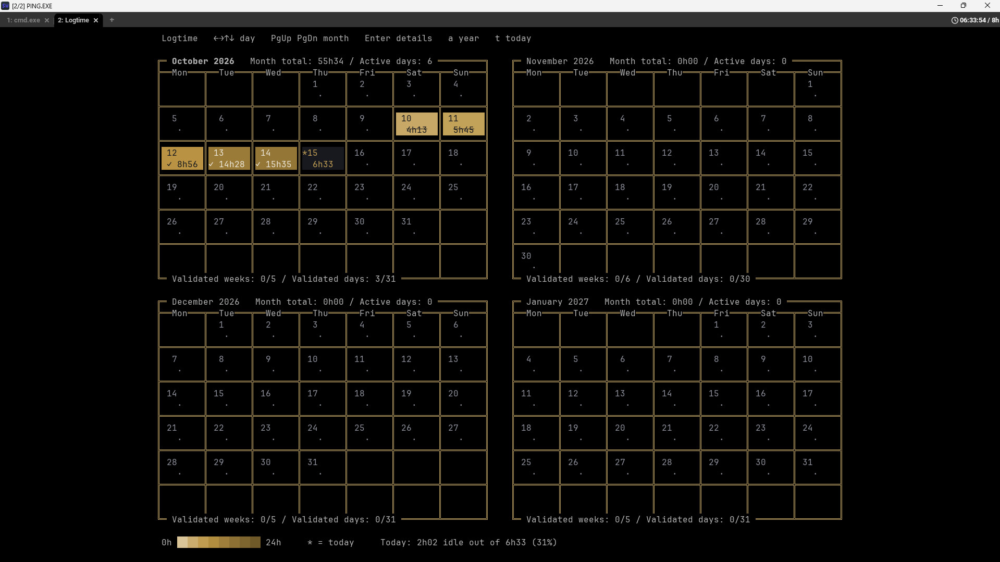
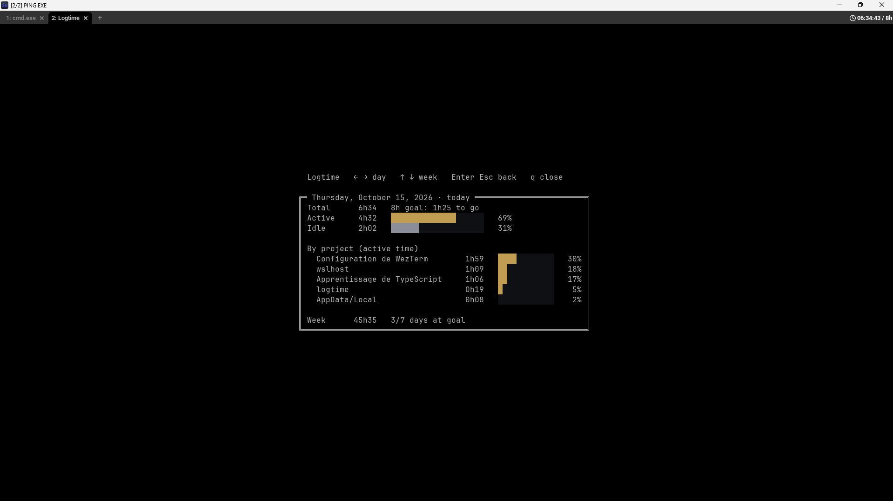
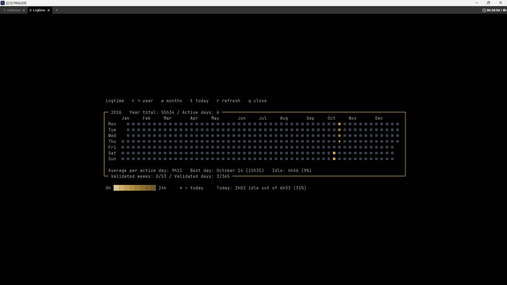
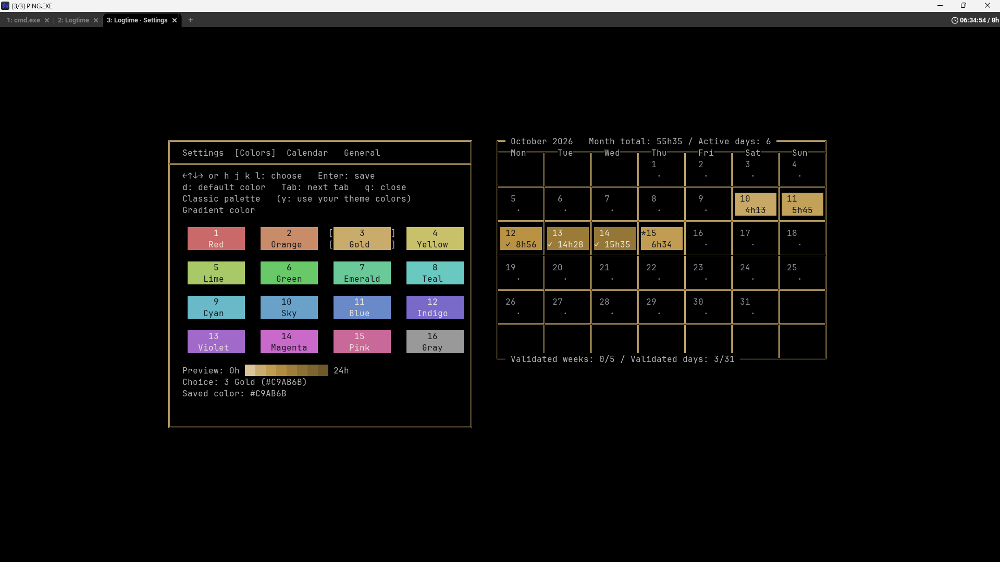

# logtime.wezterm

**English** · [Français](README.fr.md)

A [WezTerm](https://wezterm.org) plugin that **tracks the time you spend in your terminal** and shows it in the tab bar, with an **interactive calendar**, an **overview** (year, month, week, projects and timeline on one screen), a **day detail** (active / idle time, time per project) and a **settings page**. Nothing else to install: everything runs inside WezTerm.



## Features

- **Today's counter in the tab bar** (`05:12:30`), with no wiring needed: it shows up on the right of the normal tab bar, or inside [tabline.wez](https://github.com/michaelbrusegard/tabline.wez) if you use it.
- **Daily goal**: `05:12:30 / 7h`, then `✓ 07:03:10` in color, and a 🎉 notification once a day when you reach it.
- **Calendar** (`F2`): several months side by side depending on the window size, a color gradient per day, totals, streaks, validated weeks and days.
- **Overview** (`a` in the calendar), the whole picture on one full-window screen:
  - the **year**, one square per day, with the months below it;
  - the selected **month**, with the goal reached day by day and the validated weeks and days;
  - the selected **week**: two bars per day (idle and active), and its figures (total, active days, average, best day, goal);
  - the **projects of the selected day** and the **best projects of the week**;
  - the **timeline** of the selected day.

  A project keeps the same color everywhere on the screen.
- **Day detail** (`Enter` on a day): total, goal, **active and idle time**, **time per project** and the week's total.
- **Idle time**: when nothing moves in the terminal for 5 minutes, the pause is noted as idle (the counter still counts it).
- **Time per project**: each second goes to the project of the tab you are looking at (its folder, e.g. `~/42/C05/ex02` → `42/C05`).
- **Settings page** (`F4`): colors (16 colors, or your WezTerm theme's colors), calendar layout, borders, language, goal. Every change is saved and applied right away.
- **Safe storage**: atomic writes checked after writing, a backup copy, unreadable files set aside and never overwritten.
- **English and French.**

| Day detail | Overview | Settings (`F4`) |
|---|---|---|
|  |  |  |

## Installation

In your `wezterm.lua`:

```lua
local wezterm = require("wezterm")
local config = wezterm.config_builder()

-- your colors / theme first (the plugin can offer your theme's colors)

local logtime = wezterm.plugin.require("https://github.com/Kasouker/logtime.wezterm")
logtime.apply_to_config(config, {
	goal_hours = 7, -- optional: a daily goal
})

return config
```

That's all: the counter appears in the tab bar, `F2` opens the calendar, `F4` the settings.

> `apply_to_config(config, { ... })` takes **one** table of options. Call it **after** setting your color scheme if you want the plugin to offer your theme's colors.

**Updating**: WezTerm downloads a plugin only once. To get a new version, run `wezterm.plugin.update_all()` (for example from the debug overlay, `Ctrl+Shift+L`), then reload the config.

## Keys

| Key | Where | Action |
|---|---|---|
| `F2` | anywhere | open the calendar in a new tab (or bring it back) |
| `F4` | anywhere | open the settings page |

**In the calendar**: `←` `→` (or `h` `l`) previous / next day · `↑` `↓` (or `k` `j`) previous / next week · `Shift+Tab` `Tab` (or `PgUp` `PgDn`) previous / next month · `Enter` details of the selected day · `a` overview (and back) · `t` today · `r` refresh · `q` or `Esc` close.

**In the overview** (it needs a window of at least 120 columns × 34 lines): `←` `→` day · `↑` `↓` week · `Shift+Tab` `Tab` month (and the year, past December or January) · `t` today · `a` or `Esc` back to the calendar · `r` refresh · `q` close.

**In the day detail**: `←` `→` `↑` `↓` move to another day · `Enter` or `Esc` back to the calendar.

**In the settings page** (it fills the whole window, with a preview on the right when there is room: the month, then today — active and idle time, time per project, and the timeline of the day): `Tab` / `Shift+Tab` next / previous tab (Colors, Calendar, General) · arrows or `h j k l` choose · `Enter` save a color · `←` `→` change a value (saved right away) · `d` default value · `y` / `n` use (or not) your theme's colors · `q` or `Esc` close.

The page keys only act in the page's tab: a key pressed anywhere else goes to your shell as usual.

## Configuration

Options are read in this order (the last one wins): **plugin defaults → options in `wezterm.lua` → settings file** (written by the `F4` page, so your choices there always take effect).

### Settings (in `wezterm.lua` or in the `F4` page)

| Name | Values | Default | Meaning |
|---|---|---|---|
| `lang` | `"en"`, `"fr"` | `"en"` | interface language (English or French) |
| `week_starts_on` | `"monday"`, `"sunday"` | `"monday"` | first day of the week |
| `goal_hours` | `0` (none), or 0.5 to 24 | none | hours per day that count as "goal reached" |
| `goal_days` | 1 to 7 | `5` | days at the goal that make a validated week |
| `count_idle` | `true` / `false` | `true` | `false`: idle time is not counted — the counter, the daily goal, the calendar and the preview show active time only, and the overview shows one bar per day (the files still keep everything) |
| `show_timeline` | `true` / `false` | `true` | the timeline of the day, at the bottom of the preview in `F4` (Calendar tab, Preview block) and of the overview; with it, each project has its own color, the same on the timeline and in the lists of projects (without it, the bars keep the day color and the overview gives the timeline's room to the projects) |
| `max_months` | 1 to 12 | `12` | most months shown (as many as fit in the window, up to this) |
| `months_anchor` | `"last"`, `"first"` | `"last"` | the selected month is the last one shown, or the first |
| `center` | `true`, `false` | `true` | center the calendar in the window |
| `gradient` | `true`, `false` | `true` | color gradient (`false`: four levels) |
| `gradient_color` | `"#RRGGBB"` | `"#C9AB6B"` (gold) | gradient hue |
| `gradient_light`, `gradient_dark` | 0 to 1 | `0.8`, `0.3` | lightness of a very short day, and at `gradient_hours` |
| `gradient_hours` | 1 to 48 | `24` | duration that gives the darkest color |
| `gradient_curve` | 0.1 to 3 | `0.5` | curve (1 = linear; 0.5 makes the first hours easier to tell apart) |
| `borders` | `true`, `false` | `false` | borders around days, months and the settings page |
| `border_style` | `"rounded"`, `"single"`, `"double"`, `"heavy"` | `"rounded"` | border style |
| `border_color` | `"#RRGGBB"` | `"#8B8E99"` (gray) | border color |
| `theme_colors` | `true`, `false` | not answered | offer your WezTerm theme's colors in the `F4` page |

### Advanced options (only in `wezterm.lua`)

| Name | Default | Meaning |
|---|---|---|
| `open_key`, `settings_key` | `"F2"`, `"F4"` | keys of the calendar and of the settings page |
| `status` | `true` | `false`: don't show the counter (time is still counted) |
| `idle_after` | `300` | seconds without any change in the terminal before the time counts as idle |
| `day_offset` | `0` | when the day changes, in seconds after midnight |
| `save_every` | `10` | save every 10 s (when something changed) |
| `sleep_limit` | `3900` | sleep time counted per episode (65 min) |
| `data_file`, `idle_file`, `projects_file`, `timeline_file`, `settings_file` | see below | where the files are written |
| `cell_color` | none | a function `seconds -> "#RRGGBB"` (or `nil`) that replaces the day colors |
| `debug` | `false` | `true`: every key and every drawing of the pages is written to the logs |

A misspelled option is reported in the logs, with a suggestion of the right name.

## How time is counted

- The counter moves forward on every tab bar update (every second). A gap of **5 s or less** between two updates is normal time, counted in full.
- A **longer gap** (sleep, hibernation) is counted up to a **sleep budget of 65 min per episode**: a computer that wakes up for a moment and goes back to sleep doesn't count the whole night.
- The day changes at midnight (`day_offset` to change it).
- **Idle time** is noted separately: the counter keeps counting everything, and the calendar shows how much of it was idle.

## Files

Everything is stored in **`~/.local/share/logtime/`** (like WezTerm, which stores its logs in `~/.local/share/wezterm/`, even on Windows):

| File | Content |
|---|---|
| `.logtime.json` | hours per day: `{"2026-10-10":15231, ...}` (seconds) |
| `.logtime_idle.json` | idle time per day |
| `.logtime_projects.json` | active time per project and per day |
| `.logtime_timeline.json` | at what time each project was used (the timeline in `F4`) |
| `.logtime_settings.json` | the settings chosen in `F4` |
| `.logtime_focus` | which WezTerm was used last (when several are open at the same time) |
| `*.bak`, `*.corrupt-*` | a backup copy; an unreadable file set aside (never overwritten) |

**Several WezTerm open at the same time** (each one started separately) share these files safely: each writes through its own temporary file, re-reads the file just before saving (nothing another one counted is lost), and only the last one you used counts the idle time and the time per project.

Why not directly in your home folder: WezTerm reloads its whole config whenever a file changes in the config's folder or one of its direct subfolders. With a config in `~/.wezterm.lua`, saving every 10 s would reload the config all the time.

## Troubleshooting

Open the logs: `Ctrl+Shift+L` (debug overlay). On load you should see `logtime: version 1.0.3 loaded from ...`. The plugin writes its errors there, for example a misspelled option, a key already used in your config, or a save that failed.

- **No counter**: check `status` is not `false`. If you show your own status bar, call `logtime.tick(window)` in it.
- **A setting is not saved** (`✗ Not saved: …` in the `F4` page): the reason is shown at the bottom of the page, and in full (with the file path) in the logs.
- **A `⚠` next to the counter**: the last save failed (the reason is in the logs). Nothing is lost: the time waits in memory and the save is retried 10 s later.
- **The notification doesn't show**: Windows can hide notifications (Focus assist). The `✓` in the counter shows it anyway.
- **The pages' tabs show `PING.EXE` or a folder instead of `Logtime` / `Logtime · Settings`** (with [tabline.wez](https://github.com/michaelbrusegard/tabline.wez)): the plugin names its tabs, but tabline.wez's default tab sections show the folder (active tab) or the program (other tabs), never the tab's name. To show the name when a tab has one, and keep everything else as it is, use these sections (they rebuild tabline.wez's defaults):

```lua
local function has_title(tab) return tab.tab_title ~= nil and tab.tab_title ~= "" end
local function no_title(tab) return not has_title(tab) end

tabline.setup({
  sections = {
    tab_active = {
      "index",
      { "tab", icons_enabled = false, padding = { left = 0, right = 1 }, cond = has_title },
      { "parent", padding = 0, cond = no_title },
      { "cwd", padding = { left = 0, right = 1 }, cond = no_title, fmt = function(s) return "/" .. s end },
      { "zoomed", padding = 0 },
    },
    tab_inactive = {
      "index",
      { "tab", icons_enabled = false, padding = { left = 0, right = 1 }, cond = has_title },
      { "process", padding = { left = 0, right = 1 }, cond = no_title },
    },
    -- ... your other sections
  },
})
```

## Compatibility

Tested on **Windows 11 + WSL2** with WezTerm `20261005` (nightly). Linux and macOS are supported by the code but **not tested yet**: feedback is welcome.

## Development

The plugin is split into pure Lua modules (no WezTerm needed) tested with a fake WezTerm API. Run the tests with Lua 5.4:

```sh
for f in $(find tests -name 'test_*.lua' | sort); do echo "$f : $(lua5.4 $f | tail -1)"; done
```

## License

[MIT](LICENSE) © 2026 Kasouker
